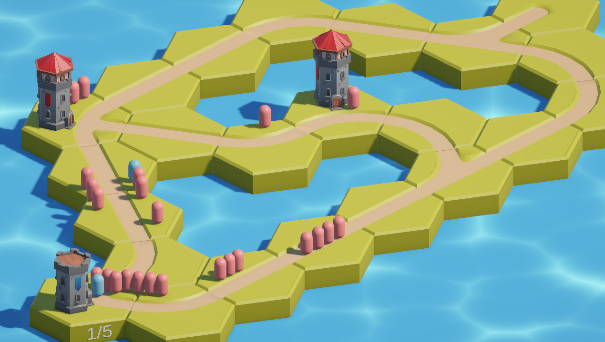
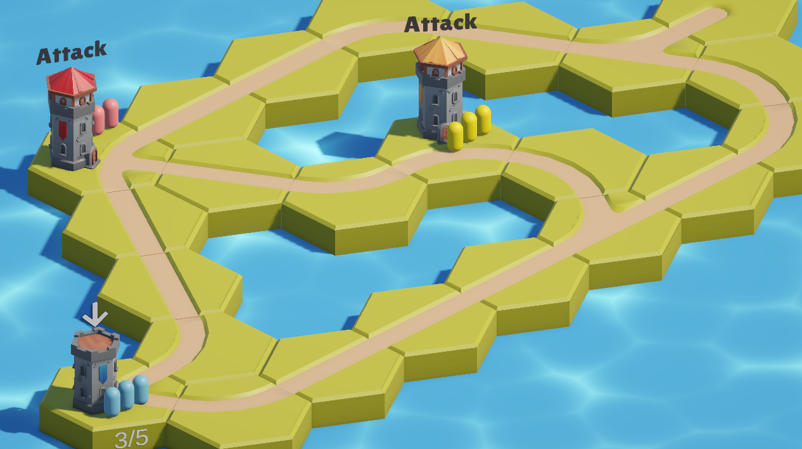
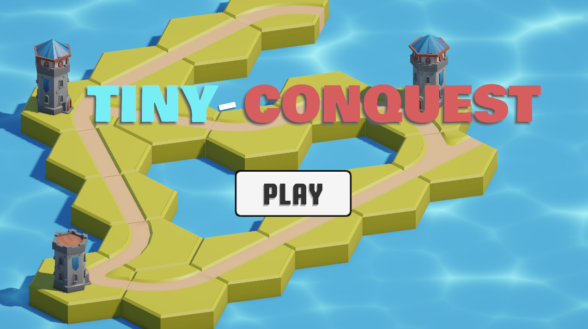
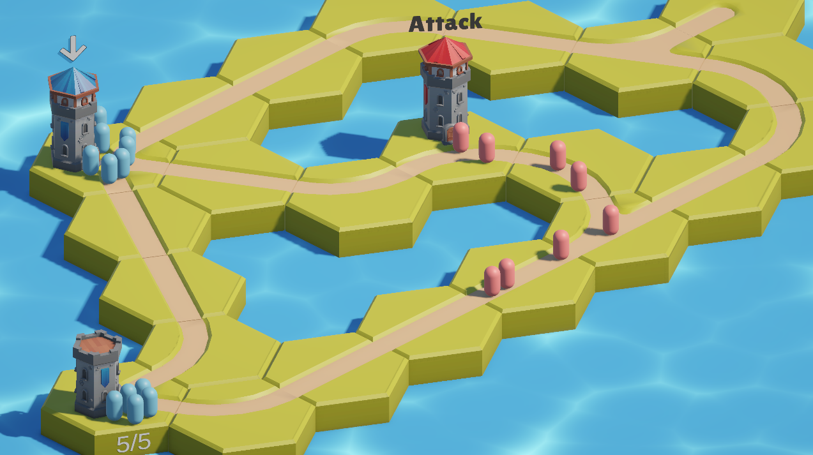

# Tiny Conquest

A Hybrid Real-Time Strategy (RTS) game!

Capture castles, train troops, battle, and conquer the map!

**Play at: https://irtaza.itch.io/tiny-conquest**

## Demo Video

[Demo Video]()

## Demo Images

|  |  |
| :-------------------------------: | :------------------: |
|             Gameplay              |    Troop Control     |

|  |  |
| :------------------------------------: | :-------------------------------: |
|              Title Screen              |             Gameplay              |

## Controls

- Tap on your tower to select it.
- Click on any neighbouring towers to send troops and battle.
- Defeat all troops of a tower to conquer it.
- Capture all towers to win!

Each tower regenerates troops at a rate of 1 troop / 3 seconds.

A troop can randomly be a swordsman or an archer.

We had also made customs 3D models for troops, but weren't able to add them into the game due to time limitations :(

## Credits

Made by **[Irtaza](https://github.com/Irtaza2009)** and **[Aayan](https://github.com/MuhammadAayanMirza)**!

[Medieval Hexagon](https://kaylousberg.itch.io/kaykit-medieval-hexagon) asset pack by **Kay Lousberg**!

Our submission for **Thirdspace** week 8 (final week!!)!
